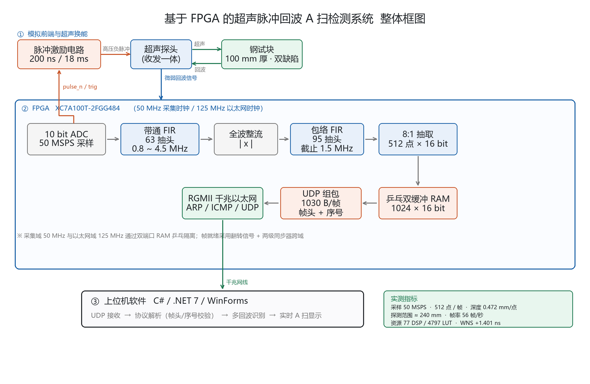

# 基于 FPGA 的超声脉冲回波 A 扫检测系统

2026 年全国大学生嵌入式芯片与系统设计竞赛 · FPGA 创新设计赛道 参赛作品

## 作品简介

以一片 Xilinx Artix-7 **XC7A100T-2FGG484** 为核心，自研模拟前端（高压脉冲激励 + 超声接收调理 + 10 bit 高速 ADC），
构建完整的超声脉冲回波 A 扫检测系统：FPGA 每 18 ms 发出 200 ns 高压激励脉冲，以 **50 MSPS** 采样回波，
经 **线性相位 FIR 带通 → 全波整流 → 包络低通 → 8:1 抽取** 得到 512 个 16 位包络点，
再通过**千兆以太网 UDP** 实时上传电脑，由 C# 上位机完成协议解析、多回波识别与实时 A 扫显示。

## 主要指标

| 项目 | 指标 |
|---|---|
| 采样率 | 50 MSPS / 10 bit |
| 单帧点数 | 512 点 × 16 bit |
| 抽取比 | 8 : 1（160 ns / 点） |
| 探测深度 | 约 240 mm（钢中纵波 5900 m/s） |
| 深度刻度 | 0.472 mm / 点 |
| 帧率 | 约 56 帧/秒 |
| 传输 | 千兆以太网 UDP，1030 字节/帧 |
| 资源占用 | 77 DSP / 4797 LUT / 6990 FF / 1 BRAM |
| 时序 | WNS +1.401 ns |

## 系统框图



## 核心技术

### 1. 全数字包络检波
以「线性相位 FIR 带通（63 抽头，0.8~4.5 MHz）+ 全波整流 + 包络低通（95 抽头，1.5 MHz）」
替代传统模拟检波二极管，无温漂、无非线性，滤波参数可重新生成系数即时修改。
带通滤波器直流增益为零，ADC 的零点偏置被自然消除，无需调零电路。

### 2. 对称 FIR「先加后乘」
利用线性相位 FIR 系数对称性 h[k] = h[N-1-k]，把首尾采样先相加再与公共系数相乘：

```
y[n] = Σ h[k]·( x[n-k] + x[n-(N-1-k)] ) + h[(N-1)/2]·x[n-(N-1)/2]
```

63 抽头只需 32 个乘法器，95 抽头只需 48 个，合计 158 阶滤波仅占 77 个 DSP48E1（器件总量的 32%）。

### 3. 乒乓双缓冲跨时钟域
采集域 50 MHz 与以太网域 125 MHz 通过 1024×16 双端口 RAM 乒乓隔离，发送第 N 帧的同时采集第 N+1 帧；
帧就绪采用「翻转信号 + 两级同步器」跨域，无竞争。

### 4. 流水线延时精确补偿
通过仿真标定整条信号链的采样延时为 **92 个采样点（1.84 µs）**，在采集状态机中先行等待再存储，
使包络点 0 严格对齐激励脉冲，深度零点误差 < 1 个点（0.47 mm）。

### 5. 带帧头的可靠 UDP 协议
载荷 1030 字节：`0xAA55 帧头 | 16 位序号(大端) | 点数=512 | 512×16bit 大端`，
配合 ARP > ICMP > UDP 发送仲裁，避免周期数据与 ping 应答在 GMII 上相撞。

## 目录结构

```
ultrasonic_udp_v2.xpr               Vivado 工程文件
ultrasonic_udp.srcs/sources_1/rtl/  RTL 源码
    ultrasonic_udp.v                顶层
    pulse_gen.v                     激励脉冲与采集触发
    dsp_chain.v                     带通-整流-包络-抽取，含采集状态机
    fir_sym.v                       通用对称线性相位 FIR
    fir_coef.vh                     自动生成的 18 bit Q1.17 滤波器系数
    frame_ram.v                     乒乓双缓冲
    frame_src.v                     UDP 数据源与协议组包
    eth_udp_tx.v / eth_ctrl.v       以太网子系统与发送仲裁
    ultrasonic_udp.xdc              引脚与时序约束
    arp/ icmp/ udp/ gmii_to_rgmii/  以太网底层
sim/                                测试台
    tb_dsp_chain.v                  信号链仿真
    tb_frame_src.v                  UDP 组包仿真
build_ultrasonic.tcl                一键综合实现脚本
design_filters.py                   滤波器设计与定点仿真脚本
docs/                               系统框图
```

## 仿真验证

| 测试台 | 检查项 | 结果 |
|---|---|---|
| tb_dsp_chain | 512 点输出、包络峰值 12160（理论 12224）、峰值点号误差 1 点 | PASS |
| tb_dsp_chain | 纯直流输入时带通输出稳态 0 LSB（直流抑制） | PASS |
| tb_frame_src | 1030 字节载荷、帧头 AA55、序号自增、512 点（含第 256 点边界）、乒乓选择 | PASS |

## 构建

Vivado 2018.3：

```
vivado -mode batch -source build_ultrasonic.tcl
```

> 仓库不含综合/实现产物（`.runs` `.cache` `.hw` `.ip_user_files` `.sim`），需本地重新生成。
> `clk_wiz_0` 与 `async_fifo_2048x8b` 两个 IP 随工程附带，若提示版本不兼容请用 Vivado 重新生成。

## 许可

仅供学习与竞赛交流使用。